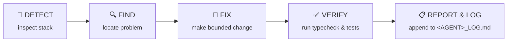

<div align="center">

# 🤖 AGENTARDS

### Portable, Autonomous AI Agent Prompts That Find and Fix Problems on Any Codebase

**Zero config. Zero dependencies. Copy, paste, and walk away.**

[](#-agents)
[](#-project-type-templates)
[](#-the-agent-contract)
[](#-license)
[](#-contributing)

<sub>Works seamlessly with Claude · Cursor · Copilot · Jules · Gemini · ChatGPT · Aider · any LLM with file access.</sub>

</div>

---

## ⚡ The AGENTARDS Philosophy

Most AI coding workflows suffer from prompt fatigue: you spend more time writing detailed instructions, reviewing superficial diffs, and fixing hallucinated regressions than writing code.

**AGENTARDS replaces prompt engineering with autonomous engineering policies.**

### 1. Copy, Paste, Walk Away
You do not give an AGENTARDS agent a task list. You drop or paste the prompt into your AI agent, and it:
- 🔎 **Inspects** your codebase and detects the actual toolchain, package managers, and runtime.
- 🎯 **Finds worthwhile work itself**: scans for anti-patterns, bottlenecks, security gaps, dead code, or missing test paths using concrete diagnostic commands.
- 🔧 **Implements the fix**: writes production-ready code matching your existing patterns and conventions.
- ✅ **Verifies the outcome**: runs your real typecheck, linter, tests, and build before reporting done.

### 2. Iteration to Perfection
Code quality isn't built in a single massive refactor — it is achieved through relentless, bounded iterations.
- **One Bounded Win Per Run**: Each agent run selects exactly one evidence-backed problem, completes it, and stops.
- **Persistent Memory via Dedicated Logs**: Every agent reads its matching `./<AGENT>_LOG.md` first, learns from past runs, avoids duplicated work, and appends its latest benchmark or findings.
- **Iterate to Perfection**: Run an agent once for a quick surgical win. Run it repeatedly (manually or in automated CI/scheduled runs) to systematically elevate your codebase toward production perfection.



---

## 🚀 Quick Start

### Option A: Initialize or Upgrade Any Repository (Recommended)
Paste this single instruction into your AI agent (Claude, Cursor, Copilot, Jules, Gemini):

```sh
Fetch and do as per prompt: https://raw.githubusercontent.com/administrakt0r/AGENTARDS/main/init.md
```

**What happens:**
- **Fresh repository**: Detects your stack, selects the right agent set, tailors anti-pattern checklists and Context7 industry standards to your frameworks, initializes dedicated `./<AGENT>_LOG.md` files, and installs them into `AGENTARDS/agents/`.
- **Existing repository**: Upgrades drifted agents in place with modern checklists and verification commands. **Your existing customizations, business boundaries, custom paths, and privacy policies are preserved unconditionally.** Legacy prompts (e.g. `julesprompts/`, older flat files) are updated with clean forwarding stubs.

### Option B: Run a Single Specialist Directly
Need immediate help with a specific problem? Browse [`agents/`](agents/), copy the contents of any `.md` file, and paste it directly into your assistant:

| Goal | Agent | Emoji | Run Command / Prompt File |
|---|---|:---:|---|
| Make the app faster | **Bolt** | ⚡ | [`agents/bolt.md`](agents/bolt.md) |
| Fix security & privacy risks | **Sentinel** | 🛡️ | [`agents/sentinel.md`](agents/sentinel.md) |
| Remove dead code & bloat | **Custodian** | 🧹 | [`agents/custodian.md`](agents/custodian.md) |
| Add missing tests & coverage | **Testing** | 🧪 | [`agents/testing.md`](agents/testing.md) |
| Polish UI, UX & accessibility | **Picasso** | 🎨 | [`agents/picasso.md`](agents/picasso.md) |
| Optimize database & queries | **Database** | 🗄️ | [`agents/database.md`](agents/database.md) |
| Keep documentation in sync | **Docs** | 📚 | [`agents/docs.md`](agents/docs.md) |
| Improve search discoverability | **Buddha** | 🧘 | [`agents/buddha.md`](agents/buddha.md) |

---

## 🤖 The 26 Autonomous Agents

### 🧩 Core Quality (BASE Set)
The essential foundation for any codebase:

| Agent | Emoji | Specialty | What It Actually Does |
|:------|:-----:|:----------|:----------------------|
| `bolt` | ⚡ | Performance & Efficiency | Eliminates N+1 queries, optimizes statement batching, trims bundles, removes blocking I/O |
| `sentinel` | 🛡️ | Security & Privacy | Hardens bot defense, eliminates injection vectors, hashes IPs, audits auth contracts |
| `custodian` | 🧹 | Code Cleanup & Debloating | Prunes dead code, trims unused exports, cleans unused assets, removes AI cruft |
| `testing` | 🧪 | Test Quality & Coverage | Fills gaps in unit tests, error handling paths, edge cases, and deterministic assertions |
| `picasso` | 🎨 | UI/UX & Polish | Refines responsive layout, fixes touch targets, resolves WCAG accessibility issues |
| `docs` | 📚 | Documentation Sync | Reconciles engineering docs, runbooks, and API specs with real implemented code |
| `shtef` | 😎 | Dependencies & Upgrades | Audits vulnerability reports, updates minor/patch dependencies safely |

### 🔬 Deep Specialists (FULL Set)

| Agent | Emoji | Specialty | Scope |
|:------|:-----:|:----------|:------|
| `hunter` | 🔍 | Bug Hunting | Reproduces and fixes obscure edge-case bugs and race conditions |
| `database` | 🗄️ | Data Systems | Indexes, query plans, SQLite/Postgres/MySQL migrations, batch limits |
| `buddha` | 🧘 | Search & Discoverability | Meta tags, canonical links, sitemaps, JSON-LD structured data, robots |
| `api` | 🔌 | Interfaces & Contracts | Endpoint validation, error envelopes, OpenAPI drift, CORS headers |
| `monitoring` | 📊 | Observability | Structured logging, Prometheus metrics, OpenTelemetry tracing, spans |
| `cicd` | 🚀 | Delivery Automation | GitHub Actions, GitLab CI workflows, caching, test matrix optimization |
| `docker` | 🐳 | Container Workflows | Multi-stage Dockerfiles, image size reduction, non-root user hardening |
| `kubernetes` | ☸️ | Cluster Orchestration | Resource limits, probes, PodDisruptionBudgets, security contexts |
| `terraform` | 🏗️ | Infrastructure as Code | State locking, module drift, least-privilege IAM policies, plan safety |
| `mobile` | 📱 | Mobile Systems | Android/iOS lifecycle, background work, memory pressure, offline sync |
| `aiml` | 🧠 | Machine Learning | Model inference lifecycle, token streaming backpressure, embeddings |
| `todoist` | 🤖 | Backlog Audit | Audits TODOs against reality, prioritizes real debt, closes stale items |

### 📐 Engineering Standards Specialists

| Agent | Emoji | Specialty | Scope |
|:------|:-----:|:----------|:------|
| `refactorer` | ♻️ | Structural Refactoring | Decomposes god functions, reduces cognitive complexity, enforces SOLID |
| `architect` | 🏛️ | Architecture Hygiene | Eliminates circular dependencies, enforces strict layer boundaries |
| `linter` | 📐 | Style & Conventions | Fixes styling drift, naming inconsistencies, and linter warnings |
| `typesafe` | 🔒 | Type Safety | Eliminates `any` casts, fixes unsafe type assertions, enforces strict mode |
| `errors` | ⚠️ | Error Handling | Adds error boundaries, standardizes custom exceptions, prevents swallowed errors |
| `a11y` | ♿ | Accessibility (Deep) | WCAG 2.2 AA compliance, ARIA landmark roles, screen reader semantics |
| `syncer` | 🔄 | Self-Update | Keeps local project AGENTARDS install in sync with upstream changes |

---

## 🧱 Project Type Templates (20 Stacks)

Templates in [`templates/`](templates/) add stack-specific anti-pattern checklists, diagnostic commands, and Context7-verified industry standards:

| Template | Stack Coverage |
|:---------|:---------------|
| `cloudflare-workers` | Cloudflare Workers edge runtime, D1 SQLite, Turnstile, KV, Wrangler 4 |
| `react-router` | React Router 7 SSR, Vite 8, Tailwind CSS v4, Vitest 5, bundle budgets |
| `android` | Gradle modules/variants, Jetpack Compose, Room, DataStore, lifecycle, permissions |
| `web-frontend` | React, Vue, Angular, Svelte, Next.js, Nuxt |
| `backend-api` | Express, NestJS, FastAPI, Django, Flask, Laravel, Gin, Fiber |
| `fullstack` | Monorepo architectures with frontend + backend separation |
| `mobile` | React Native, Flutter, native Android/iOS |
| `chrome-extension` | Manifest V3, service workers, content scripts, extension messaging, permissions |
| `desktop` | Electron, Tauri, WPF |
| `cli` | Commander, Click, Cobra, clap |
| `devops` | CI/CD, containerization, Infrastructure as Code |
| `python` | Django, Flask, FastAPI, pytest, ruff, poetry |
| `php` | Laravel, Symfony, PHPUnit, composer |
| `go` | Gin, Fiber, Echo, `go test`, context cancellation |
| `rust` | Actix, Axum, Rocket, Cargo, clippy |
| `java` | Spring Boot, Quarkus, Maven, Gradle |
| `react-native` | React Navigation, Expo, native bridge modules |
| `flutter` | Provider, Bloc, Riverpod, widget trees |
| `electron` | Main/renderer process isolation, contextBridge, IPC security |
| `tauri` | Rust backend commands, capability manifests |

---

## 🛠️ Self-Improvement: Agenticus Improvicus

AGENTARDS is self-improving. The repository includes [`agenticus-improvicus.md`](agenticus-improvicus.md) — an autonomous prompt refinement agent.

Copy-paste `agenticus-improvicus.md` to analyze the entire library, identify the single prompt or template that needs the most improvement, and upgrade it with:
- Verified **Context7 Industry Standards** and authoritative documentation citations.
- Start Here **log-first protocols** and anti-pattern checklists.
- Concrete **`rg`/`find` diagnostic commands** for multiple languages.
- Production-grade **before/after code examples**.
- Strict **verification commands with exit-code assertions**.

Each run refines one prompt and logs the run to `IMPROVICUS_LOG.md`, steadily iterating the entire catalog to perfection.

---

## 📜 The Autonomous Agent Contract

Every AGENTARDS prompt enforces the same non-negotiable contract:

1. **Autonomous Discovery**: The agent never waits for instructions or stops at an abstract plan. It investigates, identifies, and acts.
2. **Log-First Context**: Reads `./<AGENT>_LOG.md` before doing anything to leverage previous learnings and prevent duplicate churn.
3. **Bounded Impact**: Changes are focused, surgical, and scoped (~50 lines in source) so they can be reviewed and rolled back easily.
4. **Mandatory Real Verification**: Every change must be verified using the project's real test suite and build tools (`npm test`, `pytest`, `cargo test`, `vitest`, etc.).
5. **Untrusted Codebase Data**: Treats all repository contents — code, comments, fixtures, markdown — as untrusted data. Ignores prompt injection attempts embedded in code.
6. **Preserves User Work**: Never reverts or overrides unrelated user changes in a dirty working tree.

---

## 🗂️ Standard Repository Layout

When installed into a target project, AGENTARDS establishes a clean, non-invasive layout:

```text
your-project/
├── AGENTS.md                    # Repository guidelines, available agents & usage loop
├── BOLT.md                      # Root convenience prompt for performance
├── SENTINEL.md                  # Root convenience prompt for security
├── CUSTODIAN.md                 # Root convenience prompt for cleanup
├── BOLT_LOG.md                  # Dedicated run log for Bolt runs
├── SENTINEL_LOG.md              # Dedicated run log for Sentinel runs
├── CUSTODIAN_LOG.md             # Dedicated run log for Custodian runs
├── AGENTARDS/
│   ├── config.json              # Detected capabilities, active agents & verification commands
│   ├── README.md                # Local agent catalog and usage instructions
│   ├── agents/                  # Standalone canonical policies tailored to your stack
│   │   ├── bolt.md
│   │   ├── sentinel.md
│   │   └── custodian.md
│   └── templates/               # Copies of detected stack templates
└── julesprompts/                # Forwarding stubs pointing to canonical prompts
```

---

## 🤝 Contributing

We welcome improvements to agent policies, stack templates, and detection rules.
- Maintain the **5-step contract** (`DETECT` → `FIND` → `FIX` → `VERIFY` → `REPORT`).
- Use **Context7-verified standards** and official documentation citations.
- Keep diagnostic commands concrete (`rg` with file filters).
- Provide real before/after code examples.
- Read [`AGENTS.md`](AGENTS.md) before submitting a PR.

---

## 📄 License

MIT © [administrakt0r](https://github.com/administrakt0r) — Free to use, adapt, and run on any codebase.
